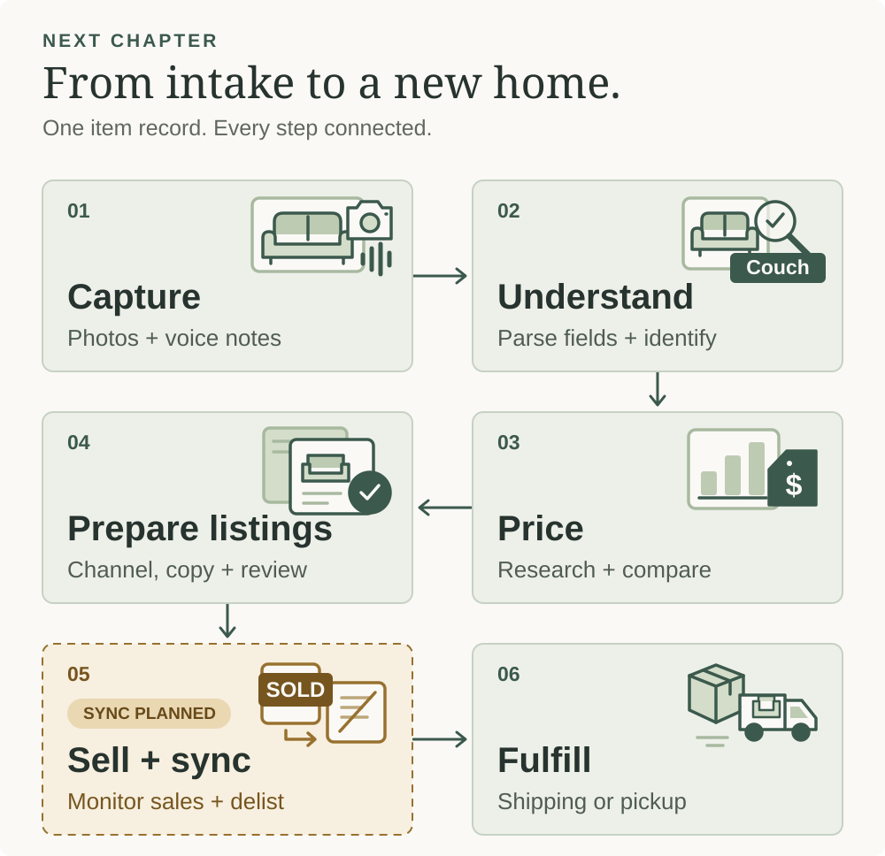
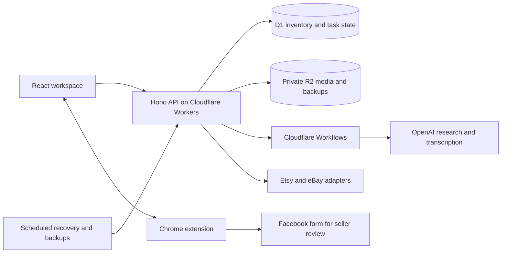

# Next Chapter

An inventory and resale workspace that turns photos and voice notes into organized items, researched suggestions, and reviewed listing drafts.



*The intended end-to-end workflow. Listing publication is assisted; automatic sale monitoring and delisting remain planned. Original vector illustration, using no client photos.*

## The problem

Small downsizing and resale teams handle a difficult mix: unfamiliar objects, incomplete owner recollections, items stored in different places, and listings spread across marketplaces. Identifying an item, estimating its value, writing descriptions, finding it after a sale, and removing duplicate listings can become a collection of disconnected manual tasks.

The physical item is easy to lose track of even when its online listing looks complete.

## How we approached it

Next Chapter keeps one inventory record at the center of the process. Photos, recordings, research, listing drafts, storage locations, and sale tasks all refer to that record. A short permanent item code connects the app to a handwritten label on the physical object.

AI helps with identification, research, pricing suggestions, and turning speech into structured details. The seller reviews those suggestions. Marketplace actions have explicit progress and confirmation rather than treating a local button click as proof that an external action succeeded.

### The workflow

1. **Start a client visit.** Choose the client once. New items inherit that context.
2. **Capture now, organize as needed.** Add a single photo or recording, or upload a collection of photos and videos. Review proposed groups and match batch voice notes to individual items.
3. **Label and locate.** Keep the assigned item code, record the room or storage bin, and print a label if useful. Moving the item preserves its code.
4. **Research and review.** Start from photos even without a name. Review a suggested identity, price range, starting price, description, sources, assumptions, and channel recommendation. A seller/client estimate remains separate from AI research and the asking price.
5. **Prepare the listing.** Edit public text, select and reorder photos, save rotations, and prepare marketplace-specific drafts. For local pickup, the Chrome helper can transfer reviewed content into Facebook's listing form.
6. **Track the sale and handoff.** Record the published link, reservation, pickup or shipping work, and outstanding listing removals. Keep the task open until the necessary confirmations are recorded.

## What is built

| Area | Current capability |
| --- | --- |
| Inventory | Persistent item records, search, statuses, client visits, locations, printable codes, version checks, and activity history |
| Capture | Single-item and bulk capture, photos/video/audio, voice recording, transcription, grouping, and reviewable field suggestions |
| Research | Photo-first identification, web-assisted comparisons, evidence categories, provisional pricing, listing suggestions, and per-search history |
| Photos | Reordering and saved rotations carried into prepared listing media |
| Facebook | Manifest V3 Chrome helper, authenticated app handshake, reviewed text/photo preparation, progress recovery, and seller-confirmed listing links |
| Etsy | OAuth, shop/profile discovery, saved drafts, and a durable unpublished-draft transfer runner |
| eBay | OAuth, saved drafts, validation, request builders, and provider adapters; seller integration remains to be completed and verified |
| Orders and removals | Durable review, duplicate protection, atomic allocation, fulfillment tasks, provider readers, polling/removal foundations, and manual tracking |
| Recovery | Scheduled private backups, media checksums, download tools, and isolated local restore checks |
| Practice | A browser-local simulated sale flow using separate practice records |

**Integration status:** this is a working application with staged marketplace integrations. Unattended marketplace publishing, live order polling, automatic cross-market delisting, buyer messaging, and shipping-label purchases are not enabled. Seller-account testing and activation work remain. The Facebook adapter has automated fixture coverage; the current live Facebook form and background-tab behavior still need validation in the seller's browser.

Etsy's transfer creates an **unpublished draft**, not an active listing. Facebook's helper prepares a form; the seller reviews it and clicks Publish. See [marketplace and extension setup](docs/marketplaces.md).

## Architecture and tech stack



| Layer | Technology |
| --- | --- |
| Interface | React, TypeScript, Vite, CSS, Lucide icons |
| API and validation | Hono, Zod, Cloudflare Workers |
| Database and files | Cloudflare D1 and private R2 buckets |
| Durable work | Cloudflare Workflows and scheduled triggers |
| AI | OpenAI Responses API with image input/web search, and Audio transcription |
| Authentication | Cloudflare Access, server-side JWT verification with `jose`, explicit email allowlist |
| Browser helper | Chrome Manifest V3, packaged JavaScript, narrow authenticated app bridge |
| Tests | Vitest, Node test runner, local Wrangler/Miniflare integration tests, optional Chrome CDP fixture checks |

The serverless design avoids maintaining an always-running application server. AI tasks have bounded inputs and daily task limits. Storage and provider usage still incur costs; task limits are not a dollar budget.

## Run locally

Use **Node.js 24+**, npm, and a `zip` executable on macOS, Linux, or WSL. The default build packages the Chrome helper as well as the web app.

```sh
npm ci
cp .env.example .env.local  # New checkout only; preserve existing secrets.
npm run build
npm run db:migrate
npm run dev:api
```

In a second terminal:

```sh
npm run dev
```

Open [the local workspace](http://127.0.0.1:5173). D1 and R2 development data stay in `.wrangler/state` and are separate from cloud data.

Optionally, while the local API is running:

```sh
npm run seed
```

This adds three fictional records with generated illustrations. The seed is repeatable and restricted to a local API. These illustrations are placeholders, not photographs or research evidence.

Inventory, draft editing, and practice mode work without AI credentials. To enable AI, set `OPENAI_API_KEY` in the ignored `.env.local` file and restart the API. Provider keys must stay on the server; do not use `VITE_` variables for them. Research sends selected photos and research facts to the provider; review those inputs before use.

## Deploy your own instance

The checked-in configuration contains a placeholder database ID, blank Access settings, and an example app hostname. Backups and marketplace connections are disabled until configured. No deployment or seller credentials are included.

Follow [the deployment guide](docs/deployment.md) to provision D1/R2, apply migrations, configure Access, add Worker secrets, and set your extension origin. `npm run deploy` includes a preflight guard and refuses an unconfigured deployment.

## Verify changes

```sh
npm run check      # Build, typecheck, unit/contracts, fresh migrations, API and restore checks
npm test           # Unit and provider contract tests
npm run build      # Typecheck, frontend build, and extension package
```

`npm run check` creates disposable local database/storage state under `work/`, disables live providers, and stops its temporary server afterward. It does not use normal inventory or a production database. GitHub Actions runs this same suite.

The tests cover concurrent edits, public/private field separation, capture recovery, duplicate order delivery, stale handoffs, uncertain external writes, photo order, authentication boundaries, and backup restore. Live AI tests and the installed-extension browser fixture are opt-in. Fixture results do not establish live marketplace compatibility or general model accuracy.

## Design decisions

- **Keep observed facts separate from suggestions.** Identification, condition, and pricing assumptions stay visible. Asking prices, reported sales, retail references, and broad AI estimates are labeled differently.
- **Make physical retrieval part of the workflow.** A sold item still needs an item code and a usable location.
- **Use explicit public fields.** Owner names, storage locations, private notes, recordings, and starting estimates are excluded from listing packages. Sellers still review public text and image backgrounds.
- **Persist work before external writes.** Revision checks, leases, and operation ledgers prevent common duplicate actions. Uncertain results stop for inspection rather than blind retries.
- **Design for interruption.** Prepared visits support queued local capture. Upload progress can resume in the same browser; browser storage eviction and device-specific recording behavior remain limitations.
- **Treat cross-market sales as a coordination problem.** Local atomic allocation prevents duplicate local fulfillment, but separate marketplaces cannot be made one atomic transaction.

## Project layout

```text
src/          React screens, capture storage, and media tools
server/       API, auth, AI jobs, marketplace adapters, backups, and orders
shared/       Schemas, state rules, pricing, and public payload contracts
extension/    Chrome helper source
migrations/   D1 schema and transactional constraints
scripts/      Build, verification, synthetic seed, and recovery utilities
tests/        Unit, contract, integration, and browser fixtures
docs/         Deployment and marketplace setup
```

This repository contains application source and synthetic fixtures. Private inventory, original photos, recordings, account identifiers, credentials, operational logs, and backups are excluded.
